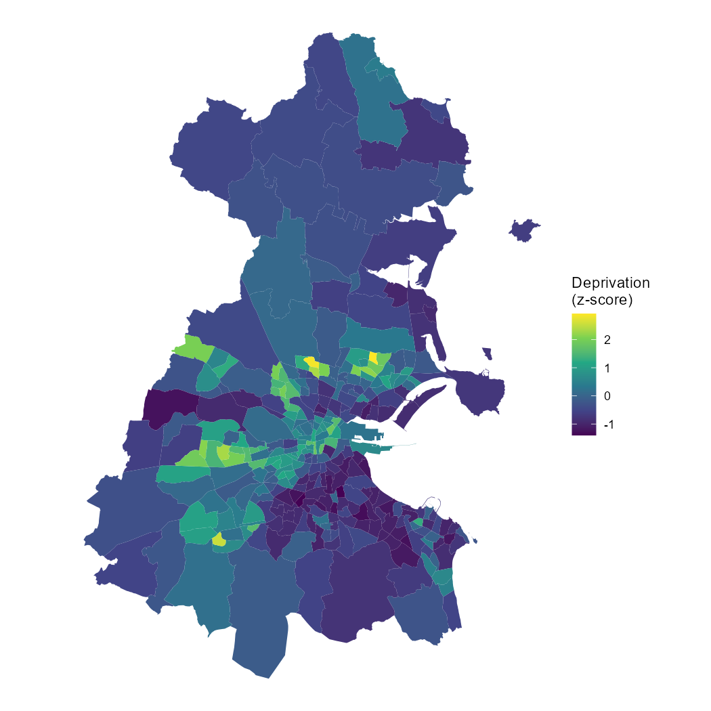

# Deprivation and public green space in Dublin: an Electoral Division–level analysis

A small, reproducible R workflow that links open land-use data to Census-derived area-level deprivation for the 322 Electoral Divisions (EDs) of Dublin, and asks whether children living in more deprived areas have less access to public green space.

**Author:** Tuğçe Aydin
**Status:** Exploratory analysis. Not peer reviewed.

## Research question

Do more socioeconomically deprived EDs in Dublin have a smaller share of public green space, once differences between local electoral areas are accounted for?

## Main result

No evidence of environmental inequality was found with this measure. The association between deprivation and public green space was weakly **positive** (the opposite of the expected direction), small, and sensitive to the model specification. For the broader green/blue measure there was no association in any model.

| Outcome | Model | Estimate per +1 SD deprivation | 95% CI |
|---|---|---|---|
| Public green urban area (%) | Linear mixed model | 1.02 | −0.09 to 2.14 |
| Public green urban area (%) | Excluding Phoenix Park | 1.00 | −0.02 to 2.02 |
| Public green urban area (%) | Adjusted for ED area | 1.04 | −0.10 to 2.19 |
| log(1 + public green urban area %) | Linear mixed model (**main model**) | 0.148 | 0.015 to 0.281 |
| Green/blue area (%) | Linear mixed model | 0.30 | −1.18 to 1.78 |
| Green/blue area (%) | Excluding Phoenix Park | 0.25 | −1.16 to 1.66 |
| Green/blue area (%) | Adjusted for ED area | 1.17 | −0.34 to 2.68 |
| log(1 + green/blue area %) | Linear mixed model | 0.083 | −0.046 to 0.211 |

The log-transformed model was chosen as the main model because the residuals of the untransformed model were strongly right-skewed (Q-Q plots). Its confidence interval excludes zero by a small margin, but it was one of eight models and was added after inspecting the residuals, so it should be read as a weak signal, not a confirmed effect. Residual spatial autocorrelation was small (Moran's I = 0.057, p = 0.035), which means the intervals may be slightly too narrow.




## Data

| Data | Source | Used for |
|---|---|---|
| Census 2022 Small Area Population Statistics (ED level) | Central Statistics Office (CSO) | Deprivation index components and child population (ages 0–14) |
| Electoral Division boundaries 2022 (generalised 20 m) | CSO / Tailte Éireann | ED geometry and local electoral area (LEA) |
| Urban Atlas Land Cover/Land Use 2018 (Dublin FUA, vector) | Copernicus Land Monitoring Service | Green and blue land-use classes |

The 322 EDs are those in Dublin City, Dún Laoghaire–Rathdown, Fingal and South Dublin. Urban Atlas covered 99.4–100% of the area of every ED in the sample.

Raw data are not stored in this repository (see `.gitignore`). Download instructions are below.

## Methods

**Deprivation index (my own construction, not the Pobal HP Deprivation Index).** Three Census 2022 indicators per ED, each standardised (z-score) within the 322 Dublin EDs and averaged with equal weights. Higher values mean more deprivation.

- Unemployment rate: (first-time job seekers + short-term + long-term unemployed) / (at work + unemployed)
- Low education share: (no formal + primary + lower secondary education) / (population aged 15+ with stated education level)
- Lone-parent share: one-parent families / all families with children

**Exposure.**

- *Public green urban area:* share of ED area in Urban Atlas class 14100 (Green urban areas).
- *Green/blue area:* share of ED area in classes 14100, 31000 (forests), 32000 (herbaceous vegetation), 40000 (wetlands) and 50000 (water).

Urban Atlas polygons were intersected with ED boundaries in the Irish Transverse Mercator projection (EPSG:2157).

**Models.** Linear mixed models (`lme4`) with a random intercept for CSO local electoral area (31 LEAs). Sensitivity analyses: excluding Phoenix Park (an extreme observation), adjusting for ED area, and a log(1 + x) transformation of the outcome. Residual spatial autocorrelation was checked with Moran's I (queen contiguity).

## Reproduce

1. Clone the repository and open `dublin-child-environmental-exposure.Rproj` in RStudio (R 4.5.1).
2. Restore the package environment: `renv::restore()`
3. Download the data into `data/raw/`:
   - CSO Census 2022 SAPS, complete set (`SAPS_2022_CSOED3270923.csv`): https://www.cso.ie/en/census/census2022/census2022smallareapopulationstatistics/
   - CSO Electoral Divisions 2022, generalised 20 m, GeoPackage, saved as `ed_boundaries.gpkg` (data.gov.ie)
   - Urban Atlas 2018, Dublin FUA, FlatGeobuf (`CLMS_UA_LCU_S2018_V025ha_IE001L1_DUBLIN_*.fgb`): https://land.copernicus.eu/local/urban-atlas/urban-atlas-2018 (free EU Login required)
4. Run the scripts in order:

```r
source("R/01_deprivation_index.R")
source("R/02_green_space.R")
source("R/03_analysis.R")
source("R/04_sensitivity.R")
source("R/05_spatial_check.R")
```

Intermediate objects are written to `data/processed/` and maps to `reports/`.

## Repository structure

```
R/01_deprivation_index.R   Census-derived ED deprivation index and child counts
R/02_green_space.R         Urban Atlas × ED intersection, land-use shares
R/03_analysis.R            Mixed models, quintile summary, maps
R/04_sensitivity.R         Eight model variants
R/05_spatial_check.R       Moran's I on model residuals
reports/                   Figures
```

## Limitations

- **Ecological design.** All results describe EDs, not individual children. Nothing here says anything about any child's exposure.
- **Exposure measure.** Urban Atlas "Green urban areas" captures planned public green space such as parks. It does not capture private gardens, and it does not measure whether a given child can actually reach the space. The positive association may partly reflect what the measure leaves out.
- **Deprivation index.** Built from three variables with equal weights. It has not been validated against established indices such as the Pobal HP Deprivation Index.
- **Spatial resolution.** EDs vary widely in size. Small-area deprivation data were not freely available.
- **Model choice.** Eight models were run and the main model was chosen after residual checks. Results are exploratory.
- **Residual spatial dependence.** Weak spatial autocorrelation remained; no spatial regression was fitted.
- **Single time point.** Census 2022 and Urban Atlas 2018 are cross-sectional and refer to different years.
- **Not covered.** Air pollution, heat exposure and remote-sensing indices (NDVI, land surface temperature) were not analysed.

## Attribution

- Census data and ED boundaries: Central Statistics Office and Tailte Éireann. Please check the providers' licence terms before reuse.
- Contains data from the Copernicus Land Monitoring Service, Urban Atlas 2018. The data were modified: polygons were intersected with ED boundaries and summarised as area shares.
